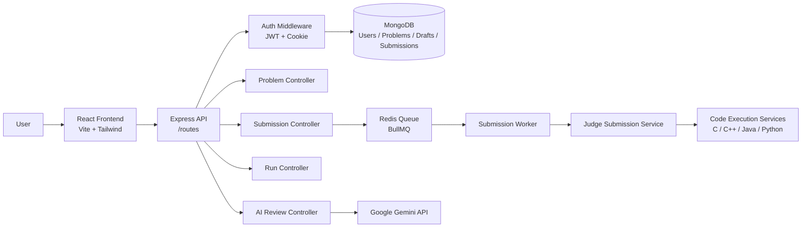
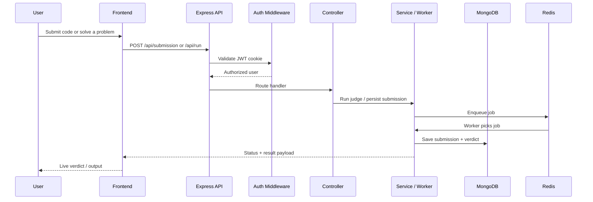
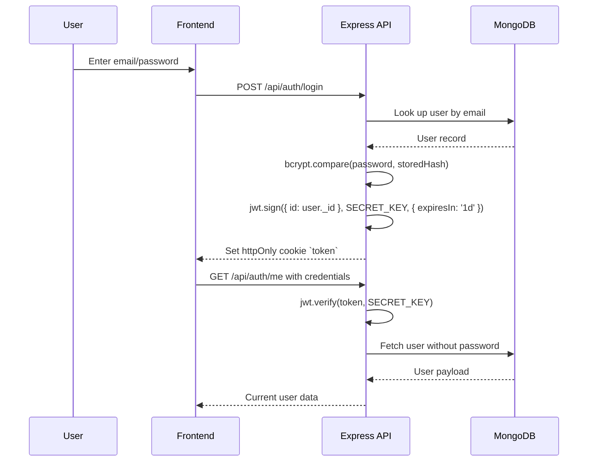
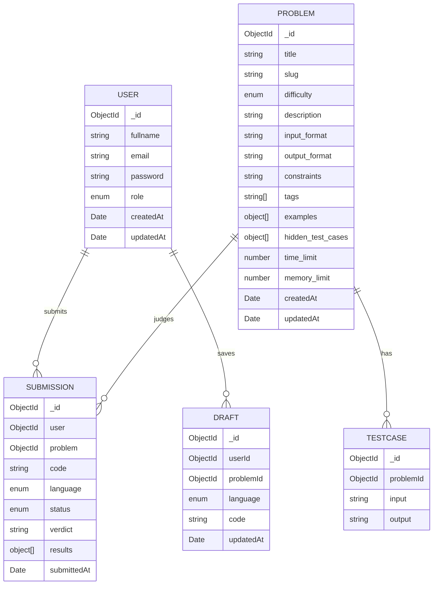
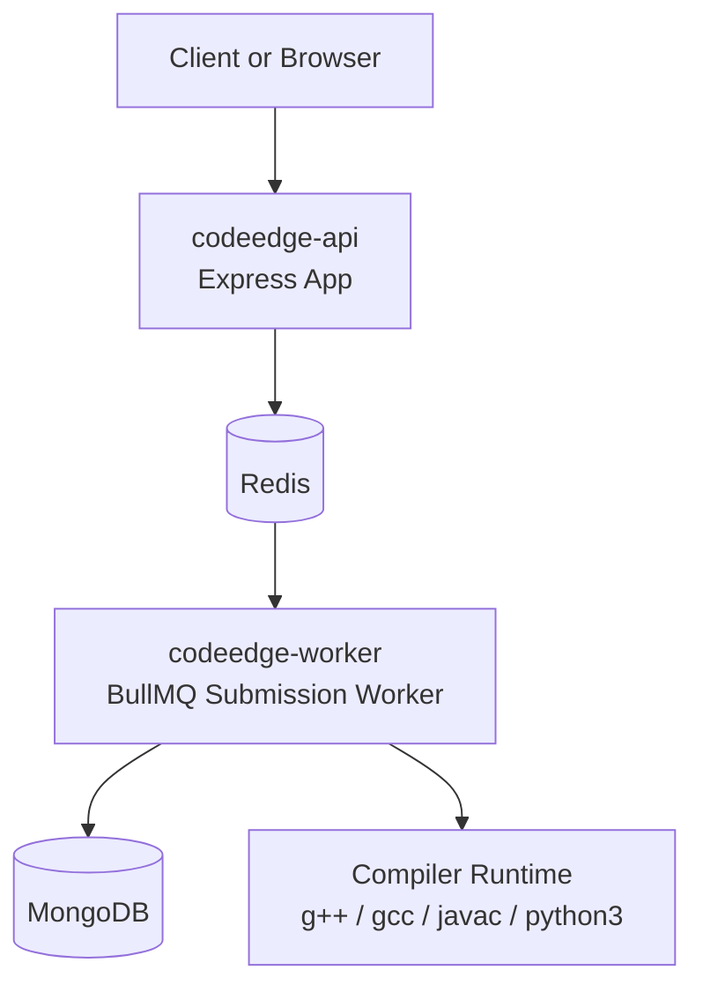

# CodeEdge

A full-stack online judge and coding practice platform for running code, submitting solutions, managing problem sets, and tracking user progress with a React frontend, Express API, MongoDB data layer, and Redis-backed asynchronous judge workers.

<p align="center">
  
  
  
  
  
  
</p>

<p align="center">
  
  
  
</p>

## Project overview

CodeEdge is an online coding platform where users can:

- write and run code in multiple languages
- browse and solve curated programming problems
- submit solutions for automated evaluation
- review code using the Google Gemini API
- save draft code per problem and language
- manage problem data through an admin flow

The application follows a clean client-server architecture. The frontend is a React + Vite app with a Monaco-based editor and route-based user experience. The backend is an Express API that handles authentication, problem management, execution requests, and judge submission orchestration. MongoDB stores users, problems, submissions, and drafts, while Redis + BullMQ provides the asynchronous queue used to judge submission jobs.

## Why it matters

This repository is interesting because it combines a typical competitive-programming workflow with product features that make it usable as a real application: authenticated user sessions, admin-only problem management, draft persistence, async queue execution, and environment-level code execution for C, C++, Java, and Python.

## Key features

### Core product features

- Online code execution with custom input for C, C++, Java, and Python
- Problem listing and detail pages with problem statements and constraints
- Automated judge evaluation against hidden or stored test cases
- Submission tracking with status and verdict history
- Draft saving per user, problem, and language
- AI code review via Google Gemini

### User experience

- React single-page application with light/dark theme support
- Monaco-based code editor for in-browser coding
- Dashboard for viewing user submissions
- Login/register flow with cookie-based JWT sessions
- Admin-only problem creation and editing routes

### Backend and engineering features

- Express API with route-based separation for auth, problems, runs, submissions, AI review, and drafts
- Middleware for authentication and admin authorization
- Mongo validation for problem and user data
- Redis-backed job queue for asynchronous submission processing
- Dockerized backend runtime environment with compilers installed in the container

### Security

- Password hashing with bcryptjs
- JWT-based auth stored in an HTTP-only cookie
- Admin authorization middleware on sensitive routes
- CORS configuration allowing configured frontend origins
- Mongo schema validation for required fields and enum constraints

## Tech stack

| Layer | Technology | Purpose |
| --- | --- | --- |
| Frontend | React 19, Vite, React Router | SPA UI and client-side routing |
| Styling | Tailwind CSS, DaisyUI | Layout and component styling |
| Editor | Monaco Editor | Browser-based code editing |
| API client | Axios | HTTP requests to backend |
| Backend | Node.js, Express 5 | REST API and application logic |
| Database | MongoDB, Mongoose | User, problem, submission, and draft storage |
| Queue | Redis, BullMQ, ioredis | Asynchronous submission judging |
| Auth | JWT, cookie-parser, bcryptjs | Session tokens and password hashing |
| AI | Google GenAI SDK | Gemini-powered code review |
| Runtime | Docker | Backend compilers and execution environment |
| Local dev | Vite dev server, nodemon | Frontend and backend development workflow |

## System architecture



## Request lifecycle

A typical user flow is:

1. The user visits the frontend, logs in, and receives a JWT in an HTTP-only cookie.
2. The browser sends requests with credentials enabled.
3. Express routes receive the request and apply auth/admin middleware where required.
4. Controllers validate inputs and invoke service logic.
5. Mongoose models persist or fetch data from MongoDB.
6. Submission requests enqueue a BullMQ job for asynchronous evaluation.
7. The worker executes the code, stores verdict results, and returns status to the client.



## Authentication architecture

Authentication is implemented using JWTs stored in an HTTP-only cookie named `token`.

### Auth flow

- Registration: `POST /api/auth/register`
- Login: `POST /api/auth/login`
- Current user lookup: `GET /api/auth/me`
- Logout: `POST /api/auth/logout`



### Auth details from the codebase

- `server/controllers/auth.controller.js` hashes passwords with `bcrypt.hash(password, 10)`.
- Login verifies the hash with `bcrypt.compare()`.
- Tokens are created with `jsonwebtoken` and set on the response as `res.cookie("token", token, { httpOnly: true, secure: true, sameSite: "None" })`.
- Protected routes use `server/middleware/auth.middleware.js` to validate the cookie and attach `req.user`.
- `server/middleware/admin.middleware.js` restricts admin-only routes by checking `req.user.role === "admin"`.

## Backend architecture

The backend is organized into a classic Express layered structure:

- `server/app.js`: creates the Express app, loads middleware, and mounts route modules.
- `server/routes/`: defines endpoints for auth, problems, runs, submissions, AI review, and drafts.
- `server/controllers/`: handles request validation and orchestration.
- `server/services/`: implements execution logic, AI review integration, file generation, and judge behavior.
- `server/middleware/`: performs auth and admin enforcement.
- `server/models/`: defines Mongoose schemas and data contracts.
- `server/config/`: connects to MongoDB, Redis, and centralizes environment configuration.
- `server/workers/`: contains the BullMQ submission worker.
- `server/queues/`: creates the Redis queue used to process submissions asynchronously.

## Database architecture

The system uses MongoDB as the primary datastore, with schema-driven validation for core entities.



### Important entities

#### User

Stored in `server/models/user.js`.

- fields: `fullname`, `email`, `password`, `role`, `submissions`
- role is restricted to `user` or `admin`
- email is unique and lower-cased

#### Problem

Stored in `server/models/problem.js`.

- required fields include title, difficulty, description, input/output format, and constraints
- `slug` is unique and generated from the title when creating problems
- `examples` and `hidden_test_cases` are required arrays
- difficulty allowed values: `Easy`, `Medium`, `Hard`

#### Submission

Stored in `server/models/submission.js`.

- references `User` and `Problem`
- tracks `code`, `language`, `status`, `verdict`, and `results`
- supported languages: `cpp`, `c`, `java`, `python`
- status values: `QUEUED`, `RUNNING`, `COMPLETED`, `FAILED`

#### Draft

Stored in `server/models/draft.js`.

- unique composite index on `{ userId, problemId, language }`
- stores unsent or partially written code state for a given problem and language

## API documentation

| Method | Endpoint | Auth | Description |
| --- | --- | --- | --- |
| POST | `/api/auth/register` | No | Register a new user |
| POST | `/api/auth/login` | No | Log in and set JWT cookie |
| GET | `/api/auth/me` | Yes | Get current authenticated user |
| POST | `/api/auth/logout` | Yes | Clear auth cookie |
| GET | `/api/problems` | No | List problems |
| POST | `/api/problems/add` | Yes, admin | Create a problem |
| POST | `/api/problems/testcases` | Yes, admin | Insert test cases |
| GET | `/api/problems/:id` | No | Fetch a single problem |
| PUT | `/api/problems/:id` | Yes, admin | Update a problem |
| DELETE | `/api/problems/:id` | Yes, admin | Delete a problem |
| POST | `/api/run` | No | Run code and return output |
| POST | `/api/submission` | Yes | Queue a submission for evaluation |
| GET | `/api/submission/user/:id` | Yes | Get submissions for a user |
| GET | `/api/submission/:submissionId` | Yes | Get submission status and results |
| POST | `/api/ai/review` | No | Review code through Gemini |
| POST | `/api/drafts/save` | Yes | Save draft code per problem/language |
| GET | `/api/drafts/:problemId/:language` | Yes | Fetch draft code |

### Example requests

#### Register

```bash
curl -X POST http://localhost:5000/api/auth/register \
  -H "Content-Type: application/json" \
  -d '{"fullname":"Jane Doe","email":"jane@example.com","password":"secret123"}'
```

#### Submit code

```bash
curl -X POST http://localhost:5000/api/submission \
  -H "Content-Type: application/json" \
  -b "token=<your-cookie>" \
  -d '{"code":"#include <iostream>\nint main(){std::cout<<\"hi\"; return 0;}\n","language":"cpp","problemId":"<problem-id>"}'
```

#### Run code

```bash
curl -X POST http://localhost:5000/api/run \
  -H "Content-Type: application/json" \
  -d '{"language":"python","code":"print(\"hello\")","input":""}'
```

## Project structure

```text
CodeEdge/
├── architecture.png
├── docker-compose.yml
├── frontend/
│   ├── .env
│   ├── eslint.config.js
│   ├── index.html
│   ├── package.json
│   ├── public/
│   ├── src/
│   ├── tailwind.config.js
│   ├── vercel.json
│   └── vite.config.js
├── README.md
├── server/
│   ├── .env
│   ├── app.js
│   ├── config/
│   ├── controllers/
│   ├── Dockerfile
│   ├── execute/
│   ├── generateInputFile.js
│   ├── inputs/
│   ├── middleware/
│   ├── models/
│   ├── package.json
│   ├── queues/
│   ├── routes/
│   ├── server.js
│   ├── services/
│   ├── tmp/
│   └── workers/
└── .gitignore
```

### Notable directory responsibilities

- `frontend/src/pages/`: route-level page components such as dashboard, compiler, problem details, and admin panel
- `frontend/src/components/`: reusable UI blocks like header, AI review panel, editor, and submission table
- `server/controllers/`: request-handler logic
- `server/services/codeExecution/`: runtime wrappers for C, C++, Java, and Python
- `server/services/submission/`: judge logic that evaluates hidden test cases
- `server/workers/submissionWorker.js`: Redis-backed background judge runner
- `server/models/`: Mongo schema definitions

## UI and architecture visuals

No application screenshots were committed as product images in the repository. The project does include an architecture diagram at [architecture.png](architecture.png), which is a high-level system overview rather than a UI screenshot.

## Docker architecture

The repository includes a Docker Compose setup for the API, worker, and Redis services.



### Docker Compose services

- `api`: runs the Express API on port `5000`
- `worker`: runs the submission worker process
- `redis`: runs a local Redis instance with a healthcheck

### Docker commands

```bash
docker compose up --build
```

To stop the stack:

```bash
docker compose down
```

## Deployment notes

The repository contains frontend SPA rewrite config for Vercel (`frontend/vercel.json`) and a frontend CORS allowlist that includes Vercel domains. There is no repository-level deployment pipeline, CloudFormation, Terraform, or production deployment manifest proving a hosted deployment environment beyond that configuration.

## Installation

### Prerequisites

- [Node.js](https://nodejs.org/) 18+ recommended
- [npm](https://www.npmjs.com/)
- [MongoDB](https://www.mongodb.com/) instance or connection string
- [Redis](https://redis.io/) instance or Docker Compose service
- [Google Gemini API key](https://ai.google.dev/gemini-api)
- Docker Desktop or Docker Engine if you want to run the bundled compose stack

### Clone the repository

```bash
git clone https://github.com/Sumit505472/dev-project.git
cd codEdge
```

### Environment variables

The repository expects these environment variables.

| Variable | Used in | Required | Purpose |
| --- | --- | --- | --- |
| `MONGO_URI` | `server/.env` | Yes | MongoDB connection string |
| `SECRET_KEY` | `server/.env` | Yes | JWT signing key |
| `GOOGLE_API_KEY` | `server/.env` | Yes | Google Gemini API key for code review |
| `PORT` | `server/.env` | Yes | Express port, default `5000` |
| `REDIS_URL` | `server/.env` and Docker Compose | Yes for queue worker | Redis connection string |
| `VITE_BACKEND_URL` | `frontend/.env` | Yes for local frontend | Backend URL used by the React app |

Example backend environment file:

```env
PORT=5000
MONGO_URI=mongodb://localhost:27017/codedge
SECRET_KEY=replace-with-a-secure-secret
GOOGLE_API_KEY=your-gemini-api-key
REDIS_URL=redis://127.0.0.1:6379
```

Example frontend environment file:

```env
VITE_BACKEND_URL=http://localhost:5000
```

## Run locally

### 1. Install backend dependencies

```bash
cd server
npm install
```

### 2. Start the backend

```bash
npm run dev
```

This starts the Express app with nodemon.

### 3. Install frontend dependencies

```bash
cd ../frontend
npm install
```

### 4. Start the frontend

```bash
npm run dev
```

The frontend typically runs on port `5173` and expects the backend at `http://localhost:5000` unless `VITE_BACKEND_URL` is changed.

## Testing

The repository currently includes linting scripts, but there does not appear to be a formal automated test suite configured with Jest, Vitest, or Mocha. The project does provide frontend linting via ESLint.

### Available validation commands

```bash
cd frontend
npm run lint
```

No backend test runner or CI test command is defined in the current repository files.

## Security

The repository implements several practical security measures:

- password hashing with `bcryptjs`
- JWT verification for protected routes
- cookie-based authentication using `httpOnly` cookies
- admin guard on sensitive routes
- CORS configuration for approved origins
- schema validation in Mongoose models for required fields and enums

This is a robust application-level security setup for a project of this size, but there is no evidence in the repo of rate limiting, helmet headers, CSRF protection, or advanced infrastructure security hardening.

## Engineering decisions

### Decision: asynchronous submission processing via Redis and BullMQ

- Reason: code execution can take time and should not block request handling.
- Benefit: the API can accept submissions quickly and complete evaluation in the background.

### Decision: cookie-based JWT auth instead of localStorage token storage

- Reason: the backend sets an `httpOnly` cookie and the frontend uses `withCredentials`.
- Benefit: reduces client-side token exposure and keeps auth tied to browser sessions.

### Decision: problem validation in controller logic before database write

- Reason: the system validates fields such as required examples, hidden test cases, time limits, and difficulty.
- Benefit: ensures invariant checks before data is persisted into MongoDB.

### Decision: per-problem and per-language draft persistence

- Reason: a user may work on multiple languages and problems concurrently.
- Benefit: draft recovery is localized and structured by `userId + problemId + language`.

## Performance and scalability

The project includes several practical patterns:

- asynchronous queue processing for code evaluation
- Redis-backed work distribution via BullMQ
- Mongo indexes on key fields such as `slug` and draft composite keys
- file-based execution isolated to generated source and output files
- frontend-only rendering through Vite and React for a low-friction developer experience

There are no repository-provided benchmark results or measured throughput numbers, so no performance claims beyond these implementation patterns should be assumed.

## Limitations

- There is no formal automated test suite in the repository.
- The project appears to rely on local environment configuration rather than a full production deploy manifest.
- The backend execution model is local to the server runtime and not isolated in a multi-container system beyond the compose stack.
- The AI code review feature depends on the `GOOGLE_API_KEY` environment value being present.
- The app sets `secure: true` and `sameSite: "None"` for cookies, which requires valid HTTPS deployment conditions to function as intended.

## Future improvements

- add a real automated test suite for API and business logic
- add pagination and filtering for large problem sets
- add rate limiting and validation hardening for public API requests
- add CI/CD workflow for linting and deployment checks
- add leaderboard, snapshots, and submission analytics
- add more languages and execution sandboxing for safer judge execution

## Contributing

1. Fork the repository.
2. Create a feature branch.
3. Make your changes in a focused manner.
4. Run applicable validation commands.
5. Open a pull request with a clear summary of the change.

## License

No license has currently been specified for this repository.

## Author

No explicit author or maintainer metadata is included in this repository.

---

CodeEdge is a practical problem-solving and coding-execution platform built from a real stack: React, Express, MongoDB, Redis, BullMQ, Docker, and Gemini AI. It is best understood as a lightweight online judge with an interactive developer experience rather than a full enterprise SaaS deployment.

If you have any questions, suggestions, or issues, feel free to reach out to me:

*  Sumit Kumar Pathak

* **Email:** pathaksumit505@gmail.com


